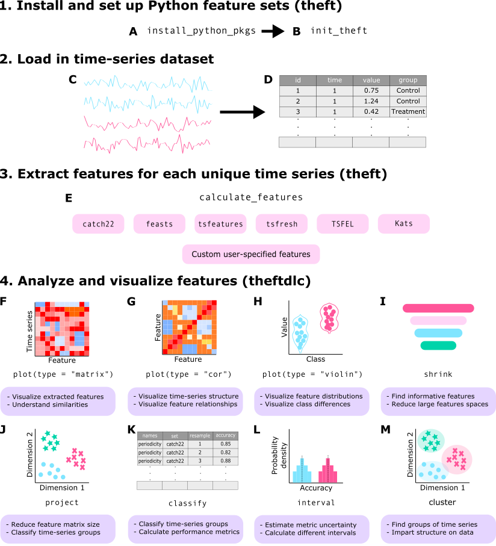
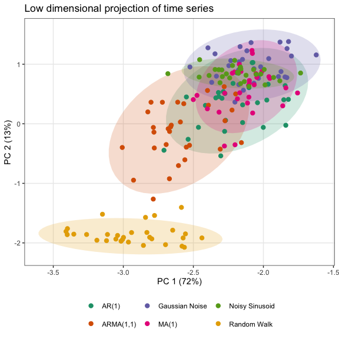

<p align="center">


</p>

<h1 align="center">

<em>theft</em>: Tools for Handling Extraction of Features from Time series
</h1>

<p align="center">

<a href="https://doi.org/10.32614/RJ-2025-023"></a>
<a href="https://zenodo.org/badge/latestdoi/351259952"></a>
<a href="https://github.com/hendersontrent/theft/blob/main/LICENSE.md"></a>
<a href="https://hendersontrent.github.io/theft/"></a>
<br>
<a href="https://cran.r-project.org/package=theft"></a>
<a href="https://cran.r-project.org/package=theft"></a>
</p>

*theft* is an R package that gives a single, consistent interface for extracting time-series features.
It provides access to $\approx 6000$ features from existing R and Python packages, and lets you add your own features.
It takes a [tsibble](https://tsibble.tidyverts.org) (a tidy temporal data frame) and returns a tidy table of feature values, ready for analysis with its companion package [*theftdlc*](https://github.com/hendersontrent/theftdlc).

📖 **Full documentation:** [hendersontrent.github.io/theft](https://hendersontrent.github.io/theft/), including the vignette and function reference.
📄 **Paper:** [“Feature-Based Time-Series Analysis in R using the Theft Ecosystem”](https://journal.r-project.org/articles/RJ-2025-023/) explains the motivation and theory behind *theft* and walks through its functionality on the [Bonn EEG dataset](https://pubmed.ncbi.nlm.nih.gov/11736210/), a well-studied neuroscience dataset.

## Installation

Install the stable version from CRAN:

``` r
install.packages("theft")
```

Or install the development version from GitHub:

``` r
devtools::install_github("hendersontrent/theft")
```

The R-based feature sets (`catch22`, `feasts`, `tsfeatures`) work straight away.
The Python-based sets (`kats`, `tsfresh`, `tsfel`, `hctsa`) need a Python installation, preferably Python 3.10 or newer.
*theft* can create a virtual environment for you with the libraries it needs:

``` r
library(theft)

# Creates a virtual environment named "theft-package" with Kats, tsfresh and TSFEL.
# Set hctsa = TRUE to also install pyhctsa (large).
install_python_pkgs(venv = "theft-package", python = "/usr/local/bin/python3.10")

# Tell R to use that environment (once per R session)
init_theft("theft-package")
```

Each library also has its own installer (e.g., `install_tsfresh()`, `install_pyhctsa()`), with a matching `init_theft_*()` function.
See `?install_python_pkgs` and the vignette for details.

## Feature sets

Pass any of these names (or several at once) to the `feature_set` argument of `calculate_features()`.

| `feature_set` | Language | Source package | Notes |
|----|----|----|----|
| `"catch22"` | R | [*catch22*](https://github.com/DynamicsAndNeuralSystems/catch22) via [*Rcatch22*](https://github.com/hendersontrent/Rcatch22), the native R implementation on CRAN | 22 features (24 with `catch24 = TRUE`) |
| `"feasts"` | R | [*feasts*](https://feasts.tidyverts.org) |  |
| `"tsfeatures"` | R | [*tsfeatures*](https://github.com/robjhyndman/tsfeatures) |  |
| `"kats"` | Python | [*Kats*](https://facebookresearch.github.io/Kats/) | Installed from [`hendersontrent/theft-kats`](https://github.com/hendersontrent/theft-kats) |
| `"tsfresh"` | Python | [*tsfresh*](https://tsfresh.readthedocs.io) |  |
| `"tsfel"` | Python | [*TSFEL*](https://tsfel.readthedocs.io/en/latest/) |  |
| `"hctsa"` | Python | [*pyhctsa*](https://github.com/DynamicsAndNeuralSystems/pyhctsa), the Python port of [*hctsa*](https://github.com/benfulcher/hctsa) (originally MATLAB) | Large feature set |

Four simple baseline sets are also available, for comparing against the more sophisticated sets (see [this paper](https://arxiv.org/abs/2303.17809) for the idea):

| `feature_set` | Contents |
|----|----|
| `"fft"` | 200 features: the squared magnitude and the angle of FFT coefficients 0 to 99 |
| `"quantiles"` | 101 quantiles |
| `"fftquantiles"` | The union of `"fft"` and `"quantiles"` |
| `"moments"` | The first four moments of the distribution: mean, variance, skewness, and kurtosis |

You can also compute your own features by passing a named list of functions to the `features` argument (see the quick tour below).
For a comprehensive comparison of six of these feature sets across a range of domains (computation speed, within-set feature composition, and between-set feature correlations), see [An Empirical Evaluation of Time-Series Feature Sets](https://ieeexplore.ieee.org/document/9679937).

## The *theft* ecosystem

The companion package [*theftdlc*](https://github.com/hendersontrent/theftdlc) (“*theft* downloadable content”, just like the [DLC](https://en.bandainamcoent.eu/elden-ring/elden-ring/shadow-of-the-erdtree) you get for video games) contains a suite of functions for analyzing, interpreting, and visualizing the features that *theft* calculates.
Collectively, the two packages are the “*theft* ecosystem”.
From `v0.6.1`, *theft* performs feature extraction only, and many functions that used to live in *theft* are now in *theftdlc* under other names.


A high-level view of how the ecosystem is typically used:



Many more functions and options are available in the packages; explore the vignettes and help files for more.

## Quick tour

*theft* and *theftdlc* combine into an efficient workflow consistent with the broader [tidyverts](https://tidyverts.org) collection of packages for tidy time-series analysis.
The code below calculates features for a tsibble of simulated time series (Gaussian noise, AR(1), ARMA(1,1), MA(1), noisy sinusoid, and a random walk; `simData` comes with *theft*).
We use the *catch22* feature set and a custom set of the mean and standard deviation, then feed the features straight into `project()` from *theftdlc*, which projects the 24-dimensional feature space into two dimensions using principal components analysis:

``` r
library(dplyr)
library(theft)
library(theftdlc)

calculate_features(data = theft::simData, 
                   feature_set = "catch22",
                   features = list("mean" = mean, "sd" = sd)) %>%
  project(norm_method = "RobustSigmoid",
          unit_int = TRUE,
          low_dim_method = "PCA") %>%
  plot()
```

<!-- -->

Here `calculate_features()` comes from *theft*, while `project()` and the `plot()` method come from *theftdlc*.

In the same way, we can compare the time-series classification performance of *catch22* against our custom set of the first two moments:

``` r
calculate_features(data = theft::simData, 
                   feature_set = "catch22",
                   features = list("mean" = mean, "sd" = sd)) %>%
  classify(by_set = TRUE,
           n_resamples = 10,
           use_null = TRUE) %>%
  compare_features(by_set = TRUE,
                   hypothesis = "pairwise") %>%
  head()
```

           hypothesis feature_set_a feature_set_b   metric set_a_mean set_b_mean
    1 User != catch22          User       catch22 accuracy  0.5533333  0.7377778
      t_statistic     p.value
    1   -4.647108 0.001207048

`classify()` and `compare_features()` come from *theftdlc*.

We can also see how each set performs relative to an empirical null distribution (i.e., how much better each set does than expected by chance):

``` r
calculate_features(data = theft::simData, 
                   feature_set = "catch22",
                   features = list("mean" = mean, "sd" = sd)) %>%
  classify(by_set = TRUE,
           n_resamples = 10,
           use_null = TRUE) %>%
  compare_features(by_set = TRUE,
                   hypothesis = "null") %>%
  head()
```

               hypothesis feature_set   metric  set_mean null_mean t_statistic
    1    User != own null        User accuracy 0.5533333 0.1177778    4.399344
    2 catch22 != own null     catch22 accuracy 0.7377778 0.1311111    7.728135
           p.value
    1 8.610084e-04
    2 1.457269e-05

See the [vignette](https://hendersontrent.github.io/theft/articles/theft.html) for more information and the full functionality of both packages.

## Citing *theft*

If you use *theft* or *theftdlc*, please cite both the paper:

> T. Henderson and B. D. Fulcher.
> [“Feature-Based Time-Series Analysis in R using the Theft Ecosystem”](https://doi.org/10.32614/RJ-2025-023).
> *The R Journal* **17**(3), 43-68 (2025).

BibTeX version:

``` bibtex
@article{RJ-2025-023,
  author = {Henderson, Trent and Fulcher, Ben D.},
  title = {Feature-Based Time-Series Analysis in R using the Theft Ecosystem},
  journal = {The R Journal},
  year = {2025},
  note = {https://doi.org/10.32614/RJ-2025-023},
  doi = {10.32614/RJ-2025-023},
  volume = {17},
  issue = {3},
  issn = {2073-4859},
  pages = {43-68}
}
```

and the software:

    To cite package 'theft' in publications use:

      Henderson T (2026). _theft: Tools for Handling Extraction of Features
      from Time Series_. R package version 0.9.0,
      <https://hendersontrent.github.io/theft/>.

    A BibTeX entry for LaTeX users is

      @Manual{,
        title = {theft: Tools for Handling Extraction of Features from Time Series},
        author = {Trent Henderson},
        year = {2026},
        note = {R package version 0.9.0},
        url = {https://hendersontrent.github.io/theft/},
      }

    To cite package 'theftdlc' in publications use:

      Henderson T (2026). _theftdlc: Analyse and Interpret Time Series
      Features_. R package version 0.2.2,
      <https://hendersontrent.github.io/theftdlc/>.

    A BibTeX entry for LaTeX users is

      @Manual{,
        title = {theftdlc: Analyse and Interpret Time Series Features},
        author = {Trent Henderson},
        year = {2026},
        note = {R package version 0.2.2},
        url = {https://hendersontrent.github.io/theftdlc/},
      }

## License

*theft* is licensed under the [MIT License](LICENSE.md).

## Acknowledgements

Thanks to [Joshua Moore](https://github.com/joshuabmoore) for his help with the Python side of *theft* and for developing *pyhctsa*.
